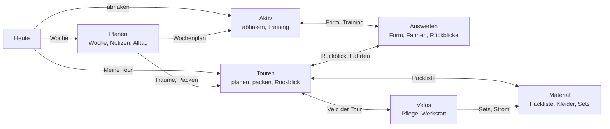
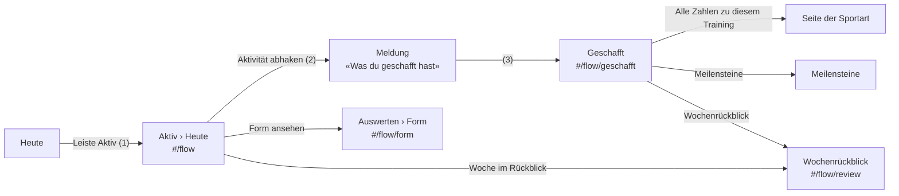
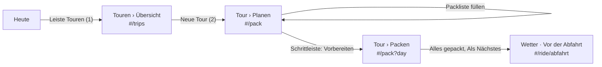
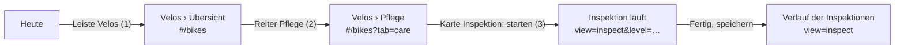

# App-Landkarte: Orte, Seiten und Absprünge

Die Skizze zeigt, wie der Packgenerator aufgebaut ist: welche Orte es gibt, was in ihnen liegt und wie man von einem zum anderen kommt. Sie ist aus dem Code gelesen (`src/lib/nav.js` für Orte und Reiter, `src/App.svelte` für die Seiten) und nennt **keine Versionsnummer und keine Zählung**, damit nicht jeder PR sie anfassen muss. Wo der Code abweicht, gilt der Code, und der PR korrigiert diese Datei.

Was jede Funktion kann, steht in [App-Stand](app-stand.md). Diese Datei zeigt nur die Wege dazwischen. Die klickbare Fassung mit einer Zeile «was du hier tust» für jede Seite, mit Sackgassen und tabellarischer Verbindungsübersicht liegt im Projekt als Artifact «App-Landkarte».

## 1. Die acht Orte und ihre wichtigsten Absprünge

Am Computer stehen sie in der Seitenleiste (Quick Links als Zeile unter Heute, Auswerten unter Aktiv, «Ich» als Karte darunter). Am Handy zeigt die Leiste unten sechs Plätze: Auswerten teilt den Platz mit Aktiv, Material mit Velos (ein Schalter oben wechselt), «Ich» steht oben rechts.

Nicht gezeichnet: «Ich» (Daten, Verbindungen, Einstellungen, Hilfe) wird von fast jedem Ort aus verlinkt. Dazu kommen Absprünge, die die App erst beim Anzeigen zusammenbaut: «Meine Tour» und der Tour-Pfad, «Passt hier» (`src/lib/passthier.js`), «Als Nächstes» (`src/lib/alsnaechstes.js`), «Gehört dazu» (`src/lib/know/gehoert.js`) und «Zahl mit Weg» (`NumLink`). Das «+ Neu» legt von jedem Ort aus Notiz, Tour, Velo-Kilometer oder einen Haken an.

## 2. Reiter je Ort

Aus `PLACE_TABS` in `src/lib/nav.js`. Am Handy zeigt ein Ort höchstens vier Reiter, der Rest steht unter «Mehr».

- **Heute** `#/`: kein Reiter. Unterseiten: Quick Links `#/quick`, Timer `#/timer`, Morgen- und Abend-Check `#/check/morning`.
- **Planen** `#/week`: Reiter Woche (Woche, Termine), Notizen (Notizen, Eingang, Merken, Tagebuch, Mail), Alltag (Alltag, Freie Zeit mit Impulsen, Kompass, Werkzeuge und Links). Die Seiten darunter sind kleine Knöpfe unter dem Reiter.
- **Touren** `#/trips`: Übersicht, Träume, Vorlagen, Rückblick, Inspiration, Skitouren, Reise-Links, Werkzeugkasten. Die Seiten einer einzelnen Tour (`#/pack`, `#/pack?day`, `#/ride`, `#/live`, `#/tour/…`, `#/trips/pfad`, `#/trips/weg`, `#/race`, `#/trips/fuel`) haben keinen Reiter und sind über die Übersicht und über Links erreichbar.
- **Aktiv** `#/flow`: Heute, Meine Aktivitäten, Training, Erholung. Ohne Reiter: Geschafft `#/flow/geschafft`, Wochenrückblick `#/flow/review`, Wochenplan `#/flow/wochenplan`, Trainingspläne `#/flow/plans`.
- **Auswerten** `#/auswerten`: Fragen, Übersicht, Analyse, Form und Erholung, Körperwerte, Fahrten, Haken ausgewertet, Wi gaht's?, Was mir gut tut, Ideen, Zusammenhänge, Gewicht, Meilensteine, Heatmap, Neuland, Gipfelbuch, Jahr. Ohne Reiter: Meine Datenquellen `#/auswerten/quellen`.
- **Velos** `#/bikes`: Übersicht, Pflege, Werkstatt, Teile, Mein Setup. Die Ansichten der Pflege (`view=inspect`, `wear`, `season`, `year`, …) sind Unterseiten.
- **Material** `#/gear`: Alles, Kleider, Bausteine, Einkauf, Vorrat, Leihliste, Sets. Ohne Reiter: Material importieren, Strom, Bausteine prüfen, Packliste aufräumen.
- **Ich** `#/me`: eine Liste von Zeilen statt Reitern (Daten und Backup, Verbindungen, Darstellung, Listen und Typen, Erinnerungen, Hilfe …).

## 3. Drei Wege von Anfang bis Ende

Die Zahl bei jedem Schritt ist die Zahl der Tipps ab Heute auf dem kürzesten Weg.

### Training erfassen bis Auswertung

### Tour planen bis packen

### Velo-Inspektion

## 4. Wie diese Datei aktuell bleibt

- Wer einen Ort, einen Reiter oder einen Absprung ändert, kann die Skizze im selben PR nachführen. Das ist ein Vorschlag, keine Regel; ob es eine werden soll, entscheidet Noah.
- Quelle für Orte und Reiter ist `src/lib/nav.js`. Stimmt die Skizze nicht mit ihm überein, gilt `nav.js`.
- Tote Adressen prüft `tests/links.test.js`; Orte und Zuhause jeder Seite prüft `tests/orte.test.js`.
- **Wege-Wächter** (`tests/e2e/wege-waechter.spec.js`): ein Roboter öffnet jede Adresse aus dem Code und prüft drei Dinge. (1) Der Pfad über der Seite beginnt mit dem Ort, der links markiert ist. (2) Die Seite hat mindestens einen Link auf eine andere Seite. (3) Die Zurück-Taste führt von der Seite wieder nach Heute. Was heute noch offen ist, steht als drei Listen oben in der Datei (`PFAD_OFFEN`, `SACKGASSE_OFFEN`, `ZURUECK_OFFEN`); die Listen dürfen nur kürzer werden, ein neuer Fall macht den Test rot.
- Befunde stehen in der jeweiligen Release-Datei, nicht hier.
