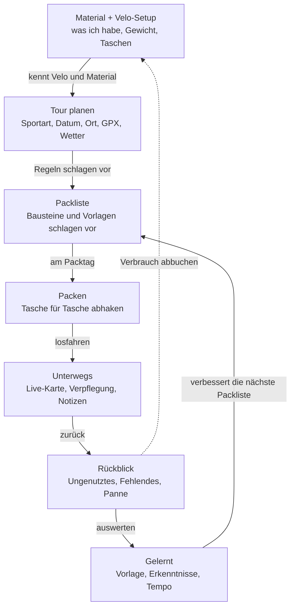
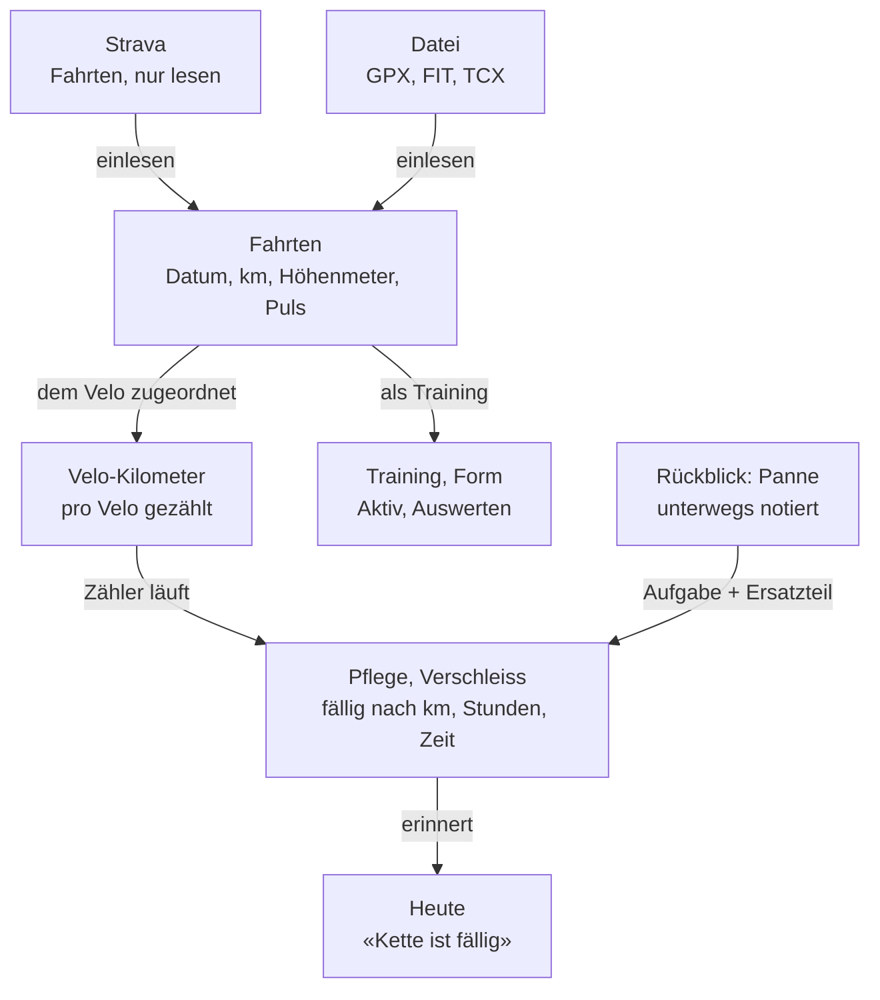
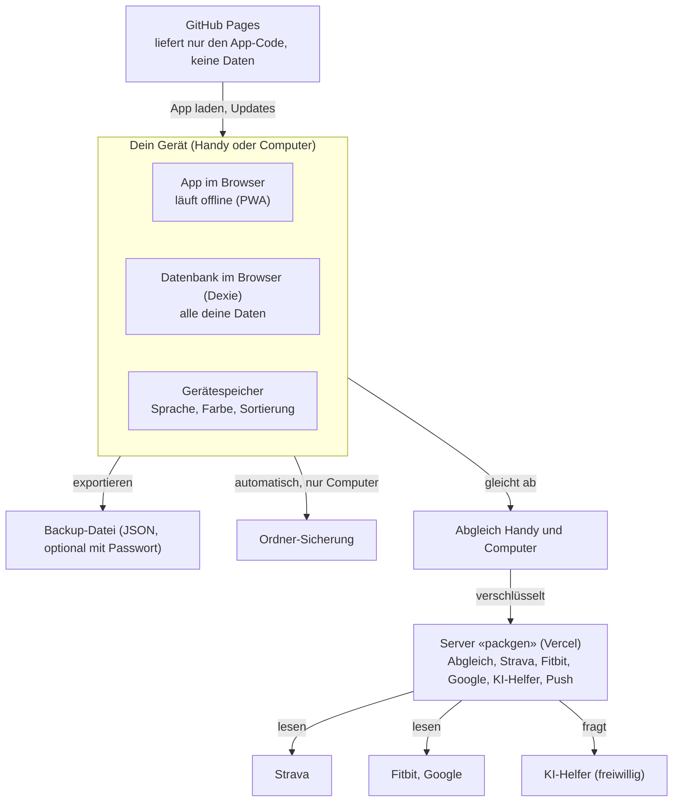

# Aufbau der App: Orte, Wege, Zusammenhänge, Daten, Regeln, Design

Eine Übersicht für Noah und für jeden, der die App neu kennenlernt. Sie erklärt den **Aufbau** (Fachwort: Architektur), die **Navigation**, die **Zusammenhänge**, die **Datengrundlagen**, die **Regeln** und die **Designregeln** in einfachen Worten, mit erfundenen Beispielen. Ein kleines Wörterbuch steht am Ende.

Sie ergänzt `docs/app-stand.md` (die Liste aller Funktionen mit Link) und ersetzt die Übersichtsteile der älteren Dokumente `docs/architecture.md` und `docs/daten.md` (siehe «Hinweis zu älteren Dokumenten»). Gilt der Code anders, gilt der Code, und der PR korrigiert diese Datei. Hier steht keine Versionsnummer und keine Zählung (Regel 13).

## 1. Aufbau: was man auf dem Bildschirm sieht

Die App besteht aus **Orten**. Jeder Ort hat **Reiter** (Unterseiten), jede Seite zeigt Karten mit Inhalt. Dazu kommen drei feste Knöpfe: **Suche**, **+ Neu** und **Ich**. Am Handy stehen die Orte unten in einer Leiste, am Computer links in einer Seitenleiste.

```
Handy (390 px)                      Computer (1440 px)
+--------------------------+        +-----------+------------------------------+
| [Suche ...]  [+ Neu] (Ich)|        | PG        | Touren                       |
|                          |        | [Suche..] | [Übersicht] Träume Vorlagen  |
| Touren                   |        | [+Neu][Ich]|                              |
| [Übersicht] Träume ..Mehr|        |           | +-------------+ +----------+ |
| +----------------------+ |        | Heute     | | Nächste Tour| | Wetter   | |
| | Nächste Tour         | |        | Planen    | +-------------+ +----------+ |
| +----------------------+ |        | Touren *  | +--------------------------+ |
| | Wetter am Start      | |        | Aktiv     | | Vorlagen                 | |
| +----------------------+ |        |  Auswerten| +--------------------------+ |
| [   Packliste öffnen   ] |        | Velos     |              [ Packliste ]   |
|--------------------------|        |  Ausrüstung|                             |
| Heute Planen Touren Aktiv|        | Material  |                              |
|        Velos  Quick      |        | Quick Links|                             |
+--------------------------+        +-----------+------------------------------+
```

| Teil | Was es ist |
|---|---|
| Suche | Findet Seiten, Material, Touren, Velos, Notizen und Aktionen. |
| + Neu | Alles, was man neu anlegt: Tour, Schnellstart, Notiz mit Foto, Gegenstand, Kilometer, Fahrt hochladen. |
| Ich | Daten und Backup, Verbindungen, Einstellungen, Aussehen, Hilfe. |
| Reiter | Unterseiten eines Orts. Am Handy höchstens vier sichtbar, der Rest unter «Mehr». |
| Orte | Die Hauptbereiche. Man kann sie ausblenden, umbenennen und umsortieren (Ich › Aussehen). |
| Hauptknopf | Pro Seite genau einer (orange), damit klar ist, was als Nächstes dran ist. |

### Die Orte und ihre Reiter

Eine Auswahl der Reiter. Alle Funktionen jedes Orts zeigt «Karte der App» (`#/me/karte`), sie wird aus `src/lib/features.js` gebaut und ist nie veraltet.

| Ort | Wofür | Reiter (Auswahl) |
|---|---|---|
| Heute | Startseite mit Kacheln (Dein Moment, Wetter, Fälliges, Körperdaten, Diese Woche, Velo im Monat, Entdecken, Neu) | keine |
| Planen | Woche, Termine, Alltag | Woche, Merken, Termine, Notizen, Tagebuch, Eingang, Mail, Kompass, Alltag, Freie Zeit |
| Touren | Planen, packen, unterwegs, Rückblick | Übersicht, Träume, Vorlagen, Rückblick, Skitouren, Reise-Links, Werkzeugkasten |
| Aktiv | Bewegung abhaken, trainieren, erholen | Heute, Meine Sportarten, Training, Erholung |
| Auswerten | Ansehen und verstehen. Hängt unter Aktiv, am Handy im gleichen Platz | Übersicht, Analyse, Form, Körperwerte, Fahrten, Wi gaht's?, Erkenntnisse, Meilensteine, Heatmap, Neuland, Jahr |
| Velos | Velos, Pflege, Werkstatt | Übersicht, Pflege, Werkstatt, Teile, Mein Setup |
| Ausrüstung | Grosses Sportmaterial (Ski, Felle). Hängt unter Velos | Hauptausrüstung |
| Material | Alle Gegenstände. Am Handy im Platz von «Velos» | Alle, Kleider, Bausteine, Einkauf, Vorrat, Verliehen |
| Quick Links | Eigene angepinnte Seiten in Gruppen | Pins |
| Ich | Oben rechts, kein Ort in der Leiste | Daten und Backup, Verbindungen, Aussehen, Eigene Werte, Listen und Typen, Handbuch, Neuigkeiten, App verstehen |

Quelle der Orte und Reiter: `PLACES`, `PLACE_TABS` in `src/lib/nav.js`; die Suchzeilen in `src/lib/nav/menu.js`.

### Unter der Haube

- **Die App** läuft im Browser (Svelte 5 + Vite). Seiten liegen in `src/pages`, Logik und Bausteine in `src/lib`. Nur «Heute» lädt sofort, alle anderen Seiten laden erst beim Öffnen (`PAGES` in `src/App.svelte`).
- **GitHub Pages** liefert die Dateien aus. Die App ist installierbar (PWA) und läuft danach auch ohne Netz.
- **Der Server «packgen»** (Vercel, Ordner `api/`) wird nur für Verbindungen nach aussen gebraucht, nicht für die App selbst.
- **Die Prüfungen** laufen bei jedem PR auf GitHub (`.github/workflows`): Bauen, Stil, Seiten am Computer und am Handy; nachts die volle Prüfung.
- **Die Texte** stehen im Code auf Englisch, die deutschen in `src/lib/i18n/de`. Ein Test schlägt an, wenn Englisch in der deutschen App auftaucht.

## 2. Navigation: wie man wohin kommt

Zu jeder Funktion führen mehrere Wege, mit Absicht. Die Adresse jeder Seite beginnt mit `#/`, zum Beispiel `#/bikes?tab=care` für die Velopflege.

| Weg | Wie er funktioniert |
|---|---|
| Orte-Leiste | Hauptweg. Unten am Handy (Heute, Planen, Touren, Aktiv, Velos und Material, Quick Links), links am Computer. |
| Reiter | Unter dem Seitentitel. Ein Ort merkt sich den zuletzt offenen Reiter. |
| Heute-Kacheln | Führen zu ihrer Seite («Fälliges» zur Pflege, «Wetter» zur Wetterseite). Kacheln zeigen, verstecken, sortieren. |
| Quick Links | Eigene Sammlung angepinnter Seiten in Gruppen. Am Handy der sechste Ort. |
| Suche | Oben. Sucht auch Aktionen («vorl» findet «Neue Vorlage»). Sprachbefehle: Ich › Sprachsuche. |
| + Neu | Der eine Weg, um etwas anzulegen. |
| Ich | Oben rechts: Daten, Verbindungen, Aussehen, Eigene Werte, Hilfe, Neuigkeiten. |
| «Passt hier» | Eine Karte dort, wo man etwas braucht, mit Sprung zu verwandten Funktionen (`PASST_HIER` in `src/lib/passthier.js`). |
| «Alles hier» | Auf Aktiv oben: zehn Kacheln zu allem, was Aktiv kann. |
| «Als Nächstes» | Nach einer Hauptaktion: was meist folgt (nach dem Rückblick zum Beispiel Tourenpass und Gelernt). |
| Funktionskatalog | `#/features`. Alle Funktionen nach Situation, Seite oder Moment, mit Suche. |
| Karte der App | `#/me/karte`. Jeder Ort mit seinen Funktionen und dem Pfad dorthin. |
| Handbuch, Assistent | `#/me/handbook` (Anleitungen, Rundgänge), `#/assistent` (Fragen zu eigenen Daten, Tourvorbereitung). |
| Pfadzeile | Auf Unterseiten steht der Weg oben («Velos › Pflege › Verschleiss»). |
| Tastenkürzel (Computer) | `g` dann Buchstabe: `h` Heute, `w` Planen, `t` Touren, `a` Aktiv, `v` Velos, `m` Material, `q` Quick Links. `/` sucht, `n` neu, `i` Ich, `?` zeigt die Liste (`src/lib/nav/keys.js`). |

Bekannte Lücke (Durchlauf 03.11.2026, siehe `docs/app-stand.md` Abschnitt 7): ein Teil der Funktionen ist am Handy nur über vier oder mehr Tipps erreichbar. «Wegweiser» und «Alles hier» sollen das verbessern.

## 3. Zusammenhänge: was womit verbunden ist

Was man an einer Stelle einträgt, taucht an anderen wieder auf. Zwei Kreisläufe tragen fast alles.

**Der Kreislauf einer Tour:** die App lernt aus jeder Tour.



**Der Kreislauf des Velos:** jede Fahrt zählt mit.



Weitere Verknüpfungen:

| Verbindung | Was passiert |
|---|---|
| Tour ↔ Wetter | Das Wetter am Start und auf der Route fliesst in die Vorschläge der Packliste ein und steht auf Heute. |
| Tour ↔ Velo | Eine Tour hat ein Velo. Dessen Taschen und Setup bilden die Plätze der Packliste. Nach der Tour zählt es die Kilometer. |
| Material ↔ Packliste | Jeder Eintrag der Packliste ist ein Gegenstand aus dem Material. Wiegen ändert das Gesamtgewicht jeder Tour. |
| Aktiv ↔ Heute | Abgehaktes, Schlaf, Ruhepuls und Tages-Check (Fitbit, Strava, von Hand) bilden «Form» und «Erkenntnisse» und erscheinen als Kacheln. |
| Wi gaht's? ↔ Erkenntnisse | Fällt ein Wert auf, stellt der Check eine offene Frage und sagt warum. |
| Freie Zeit ↔ Ausfahrt | Ein freies Zeitfenster lässt sich mit Wetter und Ziel zu einer Ausfahrt verbinden. |
| Alles ↔ Chronik | Touren, Fahrten, Pflege, Meditation und Notizen stehen zusätzlich auf einer Zeitlinie (eine Seite pro Monat). |

## 4. Datengrundlagen: wo was liegt

Alle Daten liegen **nur auf dem Gerät**, in einer Datenbank im Browser (Dexie / IndexedDB, Name `pack-generator`, `src/lib/db.js`). Es gibt kein Konto. Darum ist das Backup wichtig: Geht das Gerät verloren, sind die Daten nur noch in einer Sicherung.



| Was | Wo | Beispiel (erfunden) |
|---|---|---|
| Alles, was man erfasst | Datenbank im Browser | Velo «Beispiel-Gravel» mit 2 400 km, Gegenstand «Regenjacke 310 g», Tour «Jura, 3 Tage» |
| Einstellungen zu den Daten | Tabelle `settings`, im Backup | Kacheln auf Heute, eigene Listen, Erinnerungsabstand fürs Backup |
| Reine Bildschirm-Dinge | `localStorage` des Geräts | Sprache, Farbwelt, offene Reiter |
| Feste Listen | im Code, je Liste ein Ort | Sportarten in `src/lib/domains.js`, Checklisten in `checks.js`, Kategorien in `gear.js`. Änderbar in «Listen und Typen», der Standard bleibt unberührt |
| Eingelesene Dateien | werden auf dem Gerät gelesen, nicht hochgeladen | GPX, FIT, TCX, Strava-CSV, Fitbit-Export, Apple-Health-Export |
| Verbindungen | Server «packgen», nur über Ich › Verbindungen | Strava (nur lesen), Fitbit/Google, KI-Helfer, Push, Abgleich |

**Tabellen und ihre Besitzer.** Jede Funktion schreibt nur in die Tabellen ihres Bereichs und liest fremde nur. Die vollständige Liste steht in `DATA_TABLES` (`src/lib/db.js`).

| Bereich | Tabellen (Auswahl) |
|---|---|
| Material | `items`, `containers` |
| Touren und Packen | `trips`, `debriefs`, `learnings`, `events`, `rides` |
| Velos und Pflege | `bikes`, `maintenance`, `visits`, `photos`, `kmBook` |
| Notizen und Eingang | `notes` |
| Aktiv | `flowActs`, `flowLog`, `flowChecks`, `flowSessions`, `flowTemplates`, `flowStars` |
| App | `settings` (im Backup), `meta` (nie im Backup) |

Weitere Bereiche (Fitbit-Tageswerte, Dokumente, Reise-Spur, Sportarten, Velo-Inspektion, Freie Zeit …) haben ihre eigenen Tabellen. Nie im Backup: der Gerätespeicher `meta` und die Kopie von Google-Terminen und -Aufgaben (`gEvents`, `gTasks`, Google behält dort die Wahrheit).

**Sichern und aufs zweite Gerät bringen**

| Weg | Wie |
|---|---|
| Backup-Datei | Ich › Daten und Backup. Eine JSON-Datei mit allem, optional mit Passwort. Die App erinnert in einem Abstand, den man in «Eigene Werte» einstellt. |
| Ordner-Sicherung | Am Computer kopiert die App selbst in einen gewählten Ordner (`src/lib/folderBackup.js`). |
| Abgleich | Über den Server, verschlüsselt (`api/sync.js`, `src/lib/sync/`). Haben beide Geräte etwas geändert, fragt die App nach. |
| Vor Datenumzügen | Die App macht vorher eine Kopie (Muster `cleanup.js`). Eine Änderung am Speicher wird zuerst an der Kopie eines Backups geprüft. |

**Regeln für Daten** (aus `docs/daten.md`, weiter gültig): Persönliches nie in den Code. Eine Liste hat genau einen Ort. Alte Felder werden umgezogen, nicht ewig mitgeschleppt. Tabellen bleiben im Schema, auch leer, damit jedes ältere Backup sich öffnen lässt. Jede Tabelle hat einen Besitzer-Bereich.

**Das Repository ist öffentlich.** Dort steht nie etwas Persönliches (keine Listen, Backups, Belege, Fotos, echten Velodaten). Private Dateien liegen ausserhalb, im Projektordner unter `private/`. Tests und Bilder nutzen nur erfundene Daten.

## 5. Regeln der App, in einfachen Worten

Das Wichtigste aus `CLAUDE.md` (dort gilt der genaue Text).

**Das Ziel:** «Eine App, die mich im Alltag unterstützt.» Jede Änderung dient einem der sechs Ziele aus `docs/vorhaben.md`, sonst wird Noah gefragt: (1) Schneller packen, (2) Das Velo im Griff haben, (3) Von der Haustür bis zurück, (4) Aus jeder Tour lernen, (5) Alltag, (6) Lange Fahrten unterwegs verstehen.

**Wie sich die App verhält**

- **Alles ist ein Vorschlag.** Nichts ist Pflicht, alles änderbar und abwählbar.
- **Alles selbst ändern.** Jede Art Daten kann man hinzufügen, umbenennen und löschen. Löschen fragt im eigenen Fenster der App (`askDelete`, nie `confirm()`) und bietet «Rückgängig» (`deleteWithUndo`). Nichts ist gesperrt, weil es noch gebraucht wird: Das Fenster fragt, wohin abhängige Dinge gehen (zum Beispiel die Fahrten eines gelöschten Velos).
- **Gruppen überall.** Jede Gruppe lässt sich umbenennen und löschen. Beim Löschen fragt die App, wohin der Inhalt geht (vorgewählt «Ohne Gruppe»). Der Inhalt wird nie gelöscht. Eine neue Art Gruppe kommt in `GROUP_PLACES` (`src/lib/groups.js`).
- **Reihenfolge selbst bestimmen,** mit Pfeilen und mit Ziehen.
- **Erklärtexte,** wo man sich verirren könnte.
- **Keine Längenvorgaben** für Seiten. Heute ist eine Seite wie jede andere.
- **Privat, gratis, beobachtend.** Null Kosten. Private Daten nur ausserhalb des Repos. Gesundheitsdaten nur beobachten. Geheime Schlüssel nur im Vercel-Server.
- **Schnell starten.** Nur Heute lädt sofort; grosse Werkzeuge (PDF, Texterkennung, Bildmodelle, Video) laden bei der ersten Benutzung. Der Bau stoppt, wenn eine JS-Datei über 3 MB geht (`scripts/size-guard.mjs`).
- **Texte** gehen durch `t('English')`, mit deutschem Eintrag. Namen, die man selbst tippt, nie.

**Wann eine neue Funktion «fertig» ist (Fertig-Regel).** Sechs Teile: (1) Eintrag in `src/lib/features.js` mit Schritten und Beispiel, (2) Absprung von dort, wo man sie braucht (`PASST_HIER`, Test `tests/absprung.test.js`), (3) «Gut zu wissen»-Text mit Deutsch in `src/lib/wissen/`, (4) leerer Zustand, der sagt warum und den nächsten Schritt anbietet (`src/lib/ui/Empty.svelte`), (5) «Als Nächstes» nach der Hauptaktion, (6) Zeile in `docs/app-stand.md`. Fehlt ein Teil, steht der Grund im PR.

**Wie wir zusammenarbeiten**

- **Kleine PRs.** Eine Änderung, ein PR, keine Pakete.
- **Bilder, dann Noahs OK, dann Merge.** Jeder PR zeigt Bilder (Handy 390 px, Computer 1440 px, erfundene Daten) und 2 bis 4 Prüfschritte. Claude führt erst zusammen, wenn Noah genau diesen PR freigibt («ok 266»). Danach «Online: …». Nie automatisch. Nach dem OK bekommt der PR das Label `ok`, das die Handy-Tests startet.
- **«zurück»** macht den letzten PR sofort rückgängig.
- **Fragen:** höchstens 5 pro Runde, a/b ausgeschrieben, mit Empfehlung ★. Claude meldet sich nur mit Ergebnis, Blocker oder Frage, kurz und auf Deutsch.
- **Was fällt weg?** Jeder PR nennt, was wegfällt oder tiefer rutscht («nichts», wenn nichts), und was neu ist.
- **Dokumentation.** Jeder PR bringt eine eigene Datei in `docs/releases/` und, bei sichtbarer Änderung, eine News-Datei in `src/lib/news/`. Die Versionsnummer vergibt die Reihenfolge der Merges (`scripts/news.mjs`), nie der PR.
- **Mockups nur für Grosses** (neue Seite, neuer Ablauf).
- **Erst lesen:** vor jeder Abfrage `docs/app-stand.md` und das Projekt-Gedächtnis.

## 6. Designregeln

Noah (9.10.2026): Ein schönes Design ist so wichtig wie die Funktionen, für jede Seite, jeden Dialog und jeden leeren oder fehlerhaften Zustand. Bildsprache «Gletscher», hell und dunkel. Die Werte stehen in `src/app.css`.

| Farbe | Wert (hell) | Verwendung |
|---|---|---|
| Grund | `#eceee8` | Seitenhintergrund |
| Papier | `#fbfbf8` | Karten |
| Schrift | `#0f2e27` | Text |
| Marke | `#12372f` | Titel, Leiste, gewählter Reiter |
| Hauptknopf | `#b83e08` | Die eine Hauptaktion einer Seite |
| Gut / Achtung / Fehler | `#276a43` / `#8a5a00` / `#b42318` | Zustände, nie nur durch Farbe |

- **Schrift:** Inter, feste Stufen (Seite, Abschnitt, Unterüberschrift, Text 16 px, Label und klein 14 px). Abstände in 4, 8, 12, 16, 24, 32. Zahlen rechtsbündig in gleich breiten Ziffern. Kein Wort wird mitten getrennt.
- **Farben nur in `app.css`,** sonst nur als Namen (`var(--hi)`).

**Noahs fünf Prinzipien (PDF 8.10.2026):** (1) schrittweise zeigen, Seltenes eingeklappt; (2) kein Textlärm, Abschnittstitel plus ruhiges Symbol; (3) Hierarchie und Summen, Zahlen rechtsbündig; (4) Umschalter und kleine Abzeichen statt roter Zeilen; (5) Zeilenaktionen am Computer ruhig, am Handy immer sichtbar.

**Was jede Seite erfüllt**

- **Handy zuerst:** Tippflächen mindestens 44 × 44 px, kein seitliches Scrollen, untere Leiste erreichbar. Geprüft bei 320, 390 und 1440 px.
- **Eine Hauptaktion** pro Seite (`.btn.hi`).
- **Alle Zustände gestaltet:** leer, ladend, Fehler, erledigt.
- **Bausteine statt Eigenbau:** Knöpfe, Fenster, Karten, Leerzustand, Einklapper, Sortierpfeile, Lösch-Fenster aus `src/lib/ui`, damit alt und neu gleich aussehen.
- **Listen, die man abarbeitet, leeren sich selbst** (Zeile geht weg, nächste rückt nach, «Rückgängig»). Nicht für Listen, die sichtbar bleiben sollen (Packliste, Material).
- **Ruhige Bewegung,** abschaltbar («Bewegung: Aus», oder «weniger Bewegung» im Gerät).

**Die Wächter** (Tests, die das Design bewachen, `docs/design-audit.md`): die Stil-Prüfung (`scripts/style-lint.mjs`: keine Farben ausser `app.css`, keine zerrissenen Wörter, Schriftgrössen nur über die Stufen), der Konsistenz-Test (`tests/e2e/guard.spec.js`: rund 20 Hauptseiten bei 320, 390 und 1440 px) und «Noch alles da?» (jede Hauptfunktion von Heute aus mit höchstens zwei Tipps). Alte Verstösse stehen in der Grundlinie `tests/guard-baseline.json`, die nur kleiner werden darf.

**Die Design-Runde** bewertet jede Seite mit 1 bis 5 in acht Kriterien: Freude, Ruhe, Hierarchie, Einheitlichkeit, Handy, Lesbarkeit, Zustände, Aufwand. Eine Seite unter 4 bekommt ein Vorschlagsbild.

## 7. Kleines Wörterbuch

| Wort | Einfach erklärt |
|---|---|
| Architektur | Der Aufbau der App: welche Teile es gibt und wie sie zusammenspielen. |
| Frontend | Alles, was man sieht und antippt. Gegenstück ist das Backend, der Server im Hintergrund. |
| Ort | Ein Hauptbereich der App (Heute, Planen, Touren, Aktiv, Velos, Material, Quick Links). |
| Reiter (Tab) | Unterseite eines Orts, direkt unter dem Titel. |
| Kachel | Kleines Feld auf Heute. Lässt sich zeigen, verstecken und verschieben. |
| Sheet / Fenster | Fenster, das von unten oder aus der Mitte aufgeht (umbenennen, löschen). |
| Baukasten | Die gemeinsamen Bauteile der App (`src/lib/ui`). |
| Wächter | Automatischer Test, der bei jedem PR das Aussehen prüft. |
| Design-System | Die Gestaltungsregeln: Farben, Schrift, Abstände, Bausteine. |
| Token | Ein Name für einen Wert, etwa `--hi` für das Orange. Ändert man den Wert einmal, ändert er sich überall. |
| PWA | Web-App, die man wie eine App installiert und die offline läuft. |
| Svelte, Vite | Svelte: Werkzeug, mit dem die Seiten geschrieben sind. Vite: baut daraus die fertigen Dateien. |
| Dexie / IndexedDB | Die Datenbank im Browser. Dort liegen alle Daten. |
| Tabelle | Ein Fach der Datenbank (zum Beispiel «Velos»). |
| Schema | Der Bauplan der Datenbank. Ändert er sich, gibt es eine neue Schema-Version. |
| Migration (Datenumzug) | Einmaliges Umräumen alter Daten bei neuem Bauplan, mit Kopie vorher. |
| localStorage / Gerätespeicher | Kleiner Speicher im Browser für Bildschirm-Dinge wie Sprache und Farbe. |
| Backup | Kopie aller Daten als Datei. |
| Abgleich (Sync) | Zwei Geräte halten dieselben Daten (Handy und Computer). |
| GitHub / GitHub Pages | GitHub: wo der Code liegt (öffentlich). Pages: der Dienst, der die App im Netz anbietet. |
| Vercel / Server «packgen» | Kleiner Server nur für Verbindungen nach aussen (Strava, Fitbit, Google, KI-Helfer, Abgleich). |
| API | Schnittstelle: ein Weg, wie die App mit einem anderen Dienst redet. |
| OAuth / Verbindung | Man erlaubt der App den Zugriff bei Strava, Fitbit oder Google, ohne das Passwort zu geben. Jederzeit widerrufbar. |
| GPX, FIT, TCX | Dateiformate für Strecken und Fahrten. |
| Repo, Branch | Repo: der Ordner mit dem ganzen Code samt Verlauf. Branch: ein Seitenweg, auf dem eine Änderung entsteht. |
| PR (Pull Request) | Änderungsvorschlag. Wird geprüft und erst nach Noahs OK übernommen. |
| Merge | Eine geprüfte Änderung in die App übernehmen. Danach ist sie online. |
| Revert («zurück») | Eine übernommene Änderung wieder zurücknehmen. |
| CI | Die automatischen Prüfungen auf GitHub. Grün heisst bestanden. |
| vitest, Playwright | vitest prüft die Logik. Playwright öffnet die App wie ein Mensch am Handy und Computer und klickt durch. |
| Gesamttest | Durchlauf aller Seiten und Abläufe mit erfundenen Daten, nachts. |
| Dependabot | Roboter, der veraltete Bausteine meldet und Aktualisierungen vorschlägt. |
| News-Datei, Release-Datei | Zwei Dateien pro PR: was neu ist (in der App unter Neuigkeiten) und die Doku auf GitHub (`docs/releases`). |
| Hash-Adresse (`#/…`) | Der Teil der Adresse nach dem `#`. Er sagt der App, welche Seite offen ist. |
| Lazy Loading | Seiten werden erst geladen, wenn man sie öffnet. Das macht den Start schnell. |
| Fertig-Regel | Die sechs Teile, die eine neue Funktion braucht. |
| Thread, Koordinator, Bündler | Thread: eigenes Gespräch zu einer Aufgabe. Koordinator: spricht mit Noah im Projekt-Chat und startet Threads. Bündler: führt freigegebene PRs nacheinander zusammen. |
| Wi gaht's? | Die kurzen Fragen am Morgen und Abend zu Schlaf, Stimmung und Tag. |
| Neuland | Orte, die man zum ersten Mal besucht hat (Gemeinden, Pässe, Seen). |
| Wegweiser, «Passt hier», «Alles hier» | Hilfen, die auf verwandte Funktionen zeigen, damit nichts nur über die Suche erreichbar ist. |

## Hinweis zu älteren Dokumenten

`docs/architecture.md` (Stand Anfang Oktober 2026) und `docs/daten.md` (Stand 14.10.2026) sind in Teilen überholt: Sie nennen eine Schema-Version 4 beziehungsweise 8 und 22 Tabellen, der Code ist weiter. Ihre Regeln und Listen-Verzeichnisse (wo welche Liste liegt) bleiben gültig. Für den Aufbau, die Wege und die Daten gilt diese Datei.

Quellen: `docs/app-stand.md`, `CLAUDE.md`, `docs/design-audit.md`, `docs/vorhaben.md`, `src/lib/nav.js`, `src/lib/nav/menu.js`, `src/lib/db.js`, `src/app.css`, `api/`.
