# Pack Generator: geplante Vorhaben

Stand 10.10.2026. Die Übersicht über alles, was geplant ist, mit Warum, Was, Beispiel und Stand. Sie ist der Massstab für den Kurs-Check (unten). Die Beispiele sind zur Veranschaulichung erfunden (Zahlen, Orte, Zeiten).

## Kurs-Check: sind wir auf dem richtigen Weg?

Diese Datei wird geprüft:

- **vor jedem neuen Paket** (bevor Mockups entstehen): Passt das Paket zu einem der vier Ziele unten und zur Reihenfolge? Wenn nicht: Noah fragen, ob das Ziel oder die Reihenfolge ändert.
- **in jedem Release-PR**: Abschnitt «Stand heute» und den Stand des Vorhabens nachführen. Neue Entscheide von Noah hier und in `decisions.md` eintragen.
- **etwa alle fünf Releases**: kurzer Kurs-Check an Noah. Pro Ziel ein Satz, was erreicht ist, was fehlt und ob die Reihenfolge noch stimmt, mit a/b-Fragen, falls etwas abweicht.

Prüffragen:

1. Dient es einem der vier Ziele, und merkt Noah den Nutzen im Alltag oder auf Tour?
2. Bleibt alles ein Vorschlag, nie Pflicht, immer änderbar?
3. Bleiben private Daten auf dem Gerät und aus dem Repo?
4. Braucht es einen fremden Dienst, wo eine eigene, schlanke Lösung reicht?
5. Wurde die letzte grössere Version schon echt benutzt?

**Letzter Kurs-Check (10.10.2026, Versionen 0.68 bis 0.73, Antworten «1b 2b 3b 4a»):**
- **Schneller packen:** seit 0.66 nichts Neues; die Start-Packlisten (D5) sind freigegeben.
- **Velo im Griff:** grösster Sprung (Fahrten-Buch, Strava/Garmin-Import, Velo-Blätter). Wartungsvorschläge kommen mit dem KI-Helfer direkt nach E1.
- **Von der Haustür bis zurück:** ruhige Startseite live, Fünf Orte im Bau, E1 freigegeben.
- **Aus jeder Tour lernen:** hinkt noch hinterher; Neuland + Inspiration ist freigegeben.
- **Prüffrage 5:** kein fester Plan für eine echte Tour, Funde kommen nebenbei.

## Kurz gesagt

Der Pack Generator ist eine persönliche Web-App (PWA) für Bikepacking- und Velotouren. Sie hilft beim Packen, beim Planen und beim Lernen aus vergangenen Touren. Daten liegen nur auf dem Gerät (IndexedDB), es gibt kein Konto. Die App läuft offline und lässt sich auf Computer und Handy installieren.

Die geplanten Vorhaben verfolgen vier Ziele:

1. **Schneller packen.** Vorschläge statt leerer Listen: Bausteine, Vorlagen und ein KI-Helfer, der aus dem eigenen Material eine Liste vorschlägt. Beispiel: «3 Tage Jura, 5 °C, Biwak» ergibt eine fertige Liste mit Begründungen.
2. **Das Velo im Griff haben.** km pro Velo (später automatisch aus Strava), Wartung von Kette, Kassette, Bremsbelägen, Bremsscheiben und Reifen mit konkreten Hinweisen. Beispiel: «Kette 2 400 km seit Wechsel, mit der Lehre 0,5 messen.»
3. **Von der Haustür bis zurück.** Eine Startseite, die sich der Phase anpasst (vor, während, nach der Tour), mit SBB, swisstopo-Karte, Wetter und dem Knopf «Take me home».
4. **Aus jeder Tour lernen.** Rückblick, Learnings, die beim nächsten Packen wieder auftauchen, und ein Aktivitätsmosaik über alle Sportarten und Meditation.

Durchgehende Grundsätze: Alles ist ein Vorschlag, nie Pflicht, und immer änderbar. Private Daten bleiben privat. Keine fremden Dienste, wenn es eine eigene, schlanke Lösung gibt.

## Stand heute (13.10.2026)

| Version | Inhalt | Stand |
| --- | --- | --- |
| 0.65.0 | Velo-Masse: Sattelhöhe, Rahmengrösse, Lenkerbreite pro Velo, Import aus Datei | live |
| 0.66.0 | Bausteine neu (Biwak, Zelt, Hotel, Kochen, Erste Hilfe, Reparatur, Laden, Licht, Rennen, Essen, Hygiene, Komfort) und «Bausteine prüfen» | live |
| 0.67.0 | Übergänge Teil 1: Baukasten, Zwischenseiten «Gepackt», «Tour beendet», «Rückblick fertig», Schrittleiste, Hauptknopf nach Phase, Weitermachen auf Heute, Zurück-Taste schliesst zuerst Fenster | live seit 10.10.2026, Noah testet am Handy |
| 0.67.1 | Fix-Release: Datumsfelder mit Wochentag, Velo-Typen als Wörter, Im-Flow-Symbol im Menü; Prinzip Nr. 1 in CLAUDE.md und Arbeitsweise | live seit 10.10.2026 |
| 0.68.0 | Q1 «Jeder km zählt»: Fahrten-Buch pro Velo, Import Strava-CSV und Garmin-FIT mit Sensor-Erkennung, Wochen-Abgleich auf Heute, Startpunkt pro Teil | live seit 10.10.2026 |
| 0.69.0 | Velo-Blätter: Mappe pro Velo mit Velo-Pass, Service-Plan, Werkstatt-Auftrag und Abhol-Check; ansehen, als PDF teilen, Text kopieren; Häkchen werden Pflege-Einträge mit Startpunkt | live (PR #95) |
| 0.69.1 | Gesamttest-Runde: alle Abläufe durchgespielt, Befunde A–C behoben, D als Fragen; Import-Regel «Fahrt-Typ» (Gravel Ride → Velo) | live (PR #96) |
| 0.70.0 | Velo-Blätter Teil 2: Einfahr-Plan (von selbst bei neuem Velo, Erinnerung auf Heute), Repair-Kit pro Art der Fahrt mit «Auf die Packliste», Garantie & Belege mit Erinnerung, Diebstahl-Blatt | live (PR #98) |
| 0.73.0 | Ruhige Startseite + Fotoband: Gruss in einer Zeile, scharfes Foto (Handy: Band über der Tourkarte, «Album ›»), Vorschlag als schmale Zeile, kein doppeltes «Weitermachen» | live (PR #99) |
| 0.75.0 | Feinschliff: ein Umbenennen-Blatt überall mit Rückgängig, Zurück-Taste speichert, Import fragt neue Fahrt-Typen einmal, Teile-Fenster mit Zusammenfassung und leichteren Alternativen, Erste Hilfe auf jeder Tour, 44-px-Tippflächen | live |
| 0.76.0 | Fünf Orte Teil 1: fünf Orte (Aktiv neu), «Ich» oben rechts statt «Mehr», runder +-Knopf am Handy, Seitenleiste am Computer, Ortsfarben, Tastenkürzel | live seit 10.10.2026 (PR #100, mit #103) |
| 0.77.0 | KI-Helfer eingeschaltet (aus PR #89, in Fünf Orte gesetzt, K1–K3 a): Ich › Helfer, «Frag den Helfer» oben in Neue Tour, Antwort in der Suche, «Liste prüfen» neben «Weiter zu Packen» (Handy: Funkel-Knopf links in der Leiste), Rückblick-Entwurf, Wartungsvorschläge in «Jetzt fällig» | live seit 10.10.2026 (PR #104) |
| 0.78.0 | Fünf Orte Teil 2: Tabs pro Ort mit Wischen, letzter Tab bleibt, alte Adressen mit Hinweis, «Was ist neu» als Blatt, Touren-Einstieg mit Kacheln und Bestwerten, Rückblick «offen» zuerst, Material › Einkauf | gemergt 10.10.2026 (PR #105) |
| 0.79.0 | Hobby-Seiten Teil 1: Aktiv › Aktivität (sechs Kacheln mit verspielten Namen, Ringe, Vorschläge, Erholung und Ideen) und Meilensteine über alle Aktivitäten (Stufen, Sterne bleiben, eigene Zahlen, Belohnung) | gemergt 11.10.2026 (PR #106) |
| 0.81.0 | Hobby-Seiten Teil 2 «Kissenzeit»: Meditations-Seite (Vorlagen, Wie letztes Mal, Arten, Herausforderung, Meilensteine, Klänge, Zitate, Links, Orte), Intervalle mit Marken auf der Uhr, Sitzung im ganzen Bildschirm | PR offen |
| 0.84.0 | Hobby-Seiten Teil 3 «Nach dem Gong»: Auswertung mit Notiz, Tiefe, Stimmung und «Als Nächstes» (.ics), Protokoll mit Filtern, Serien-Wärmebild, Kalender und Grafik, Sitzung im Detail mit «Wieder so starten» | PR offen |
| 0.86.0 | Meditation einfach (Noah «1-5 a»): Startblatt aus «Heute abhaken» (Jetzt {n} Min, Dauer, Nur abhaken), kurze Meditations-Seite mit «Mehr», nach dem Gong nur Satz, Tiefe und «Fertig», ruhige Uhr; «Diese Seite kann», «geplant» und Wisch-Hinweis weg | PR offen |
| 0.97.0 | Design-Refresh R1 «Darstellung» (G1 neu freigegeben 11.10. 23:10, Noah 12.10. «1a 2a 3b 4a 5a»): Farbwelt Salbei und Schrift Inter als neuer Standard; Ich › Darstellung mit 8 Schriften, 7 Farbwelten (die bisherigen bleiben), Schriftgrösse Klein/Normal/Gross, hell oder dunkel, Vorschau am Computer | live |
| 0.98.0 | Design-Refresh R2 «Heller Kopf» (G4/G5 A★): heller Kopf und helle Seitenleiste, «Neu» oben neben der Suche statt rundem Knopf, «Ich» als Karte unten in der Seitenleiste | live |
| 0.118.0 | Was ist neu 2 (W1–W3, Noah «w1-w3 freigeben» 13.10.2026, «1a 2a 3a 4a 5a»): alle Versionen neu erzählt mit Titel, Satz, Hauptpunkten mit › und Kleinkram in Kästchen, Fenster nach Update mit «Looos», Liste nach Monat; KI-Helfer ausblenden (K1–K4 «k1-k4 ok»): von Anfang an aus, ein Schalter unter Ich › KI-Helfer für alle Stellen | Branch fertig, PR nach #141 |
| 0.117.0 | Knöpfe neu (Mockups N1–N4, Noah «n1-n4 freigeben» 12.10.2026, «1a 2a 3a 4a 5b»): jeder Knopf erklärt sich (Maus, Tastatur, langes Drücken), ein Hauptknopf plus «…» mit Erklärzeilen, Knöpfe rechtsbündig bzw. am Handy unter dem Text, Knopftext höchstens 2 Wörter auf allen Seiten | Branch fertig, PR wartet auf Noahs Freigabe zum Veröffentlichen |
| 0.116.0 | E3 «Strava-Verbindung» (S1–S5): Velo › Pflege › Strava verbinden, alle alten Fahrten holen ohne Doppelte, automatisch beim Öffnen oder per Knopf, Fahrt ohne Velo zum Prüfen mit Vorschlag, «Velo in Strava geändert» auf Heute und beim Velo, Kachel «Strava», Datei-Import als Reserve; Puls Ø/max pro Fahrt an sechs Orten (P1–P6) | PR offen |
| 0.115.0 | Menü-Fix (Noah «dringend»): jedes •••-Menü schliesst mit einem Tipp daneben, nicht erst beim zweiten Tipp auf ••• (Velopflege › Probleme, Velo-Check, Packliste, laufende Touren). | live seit 12.10.2026 |
| 0.114.0 | «Rahmenbedingungen» (B1–B3): Fenster für eine neue Tour mit Sportart, Wetter aus der PLZ, Event, Vorlagen als Knöpfe (keine «Letzte Tour»), Packliste in vier Gruppen; Reparatur und Laden nicht mehr von selbst | live |
| 0.111.0 | Bausteine bearbeiten Teil 1 (Mockups V1–V6, Noah «v1-v4 ok» und «v5-6 ok» 12.10.2026): Vorabend-Check als Zeile auf «Gepackt» mit eigenem Fenster, Schluss-Check unter «Bevor du auspackst» auf «Tour beendet», «Liste anpassen» (sortieren, entfernen, Eigenes, Vorschläge aus früheren Rückblicken, für diese Tour oder alle der Reiseart), neue Seite Ich › Checks pro Reiseart | live |
| 0.110.0 | Design-Refresh P10 «Was ist neu» (I11, I11b–I11e): Ich › Was ist neu mit neuester Version, allen Funktionen (Neueste, Name, Kategorie, Ort, Deine Top 10, Wichtigste 10, Suche) und Versionen nach Monat; Meldung nach Update mit «Nicht mehr anzeigen»; Kachel «Neu» 14 Tage oben auf Heute | live |
| 0.109.0 | Design-Refresh P6 «Rückblick, Auswerten, Fahrten» (T14–T23): Tour beendet, Rückblick in zwei Spalten, Übersicht, Gelernt, Tempo, Logbuch, Vergangene Touren, Fahrten im neuen Stil | live |
| 0.108.0 | Design-Refresh P9 «Ich» (I1–I10, I12, I13, B20, B35): Ich in vier Gruppen, Daten und Backup mit Status-Lichtern, Aufs Handy mit QR-Code, Eingang, Notizen, Helfer, Wohnort, Spielwiese im neuen Stil | live |
| 0.107.0 | Design-Refresh P8 «Aktiv» (A1–A8, A13, A14, A14c): Aktiv heute, Ziele, Aktivität, Meilensteine, Meditation «Mehr», Logbuch neu und Seite «Muster»; Vorschläge als Challenge | live |
| 0.106.0 | Design-Refresh P5 «Packen und Unterwegs» (T6–T13): Taschen als eine Liste, helle Fenster, Gepackt mit «Bis zum Start», Unterwegs mit dem Tag in Blöcken und Stunden-Wetter | live |
| 0.105.0 | Design-Refresh P7 «Velo» (V1–V14): Velo-Seite, Fenster, Mappe, Pflege mit eigener Seite pro Velo, Import, Werkstatt und Belege, Ausstattung und Vergleich im neuen Stil | live |
| 0.104.0 | Design-Refresh P4 «Touren» (T1–T5, T24, B02, B26): Übersicht mit «Weitermachen», Neue Tour als ein Fenster, Vorlagen, Planen mit Karte, Höhenprofil, Gewicht nach Ort, Etappen und Wetter an den Zeltplätzen | live |
| 0.103.0 | Design-Refresh P3 «Material» (M1–M6): Liste zuerst, eine Werkzeugzeile, Ansichten rechts, Teil-Fenster mit «Mehr», Filtern/Zuordnen/Zusammenlegen/Wiegen im neuen Stil | live |
| 0.102.0 | Vorschlag und Challenge (D1b/D5, «d1-d5 freigeben»): «Heute baden oder Sauna?» mit Alternativen, jeder Vorschlag als Challenge, zählt von selbst, wird Meilenstein | live |
| 0.101.0 | Design-Refresh P2 «Heute» (H1–H9): heller Kopf, Tour-Karte mit Zahlen und Packbalken ohne Foto, helle Kacheln, vier neue Kacheln, «Neu» nach Bereichen, helle Suche | live |
| 0.100.0 | Design-Refresh P1 «Zurück, Schritte, Weiter-Leiste» (G7, «10 Pakete»): heller Tour-Kopf mit «‹ Touren › Name», nummerierte Schritte, Weiter-Leiste unten | live |
| 0.99.0 | Design-Refresh R3 «Bausatz» (G2/G3, Noah 3b): Knöpfe, Felder und Abzeichen mit weicher Ecke und 44 px, leere Seiten als ruhige Karte, Konfetti beim grossen Feier-Moment, Hinweise mit Haken und «Rückgängig» | live |
| 0.96.0 | F1 Alles finden (Noah «1-5 a», Mockups A/B): «Was die App kann» mit 84 Funktionen in 6 Gruppen nach Situation, nie Benutztes zuerst, «Hinbringen» und «Ausprobieren», Suchfeld und Chips; die Suche zeigt 3 Befehle, letzte Suchen und findet Funktionen | PR offen |
| 0.95.0 | Velo kurz (App einfach 5a, Mockup D): Velos › Übersicht mit drei Zeilen (Velopflege, Taschen, Ausstattung), Knopf «Fahrten importieren» (Strava, Garmin) und «Mehr» für alles andere; Ausstattung ohne orange Hinweise | PR offen |
| 0.94.0 | Kachel-Wand (Noah «1-5 a», «ok a», Mockups A–D): Heute als Wand aus Kacheln in vier Grössen, anpassbar (auch lange drücken), «+» mit Katalog, «Neu»-Punkt, eine Serie über alles mit Ruhewoche, alle Meilensteine auf einer Seite, Daten und Backup unter Ich; ersetzt den Entwurf «Startseite dicht». Später K6/K7 mit Mockups | live, PR #111 |
| 0.93.0 | Meditation Wünsche (Noah «1-5 a», Mockups F–H): Neue Sitzung mit Sternen zuerst, Dauer 10–60 oder frei, Klänge keine · zufällig · eigene (alle N Minuten oder an Minute), «Als Vorlage speichern?» mit Namensvorschlag; vier Uhren Ring · Sanduhr · Mond · Zahl, gemerkt, Sanduhr mit ausblendbarer Zeit | live |
| 0.92.0 | Rückblick antippen (App einfach 4a, Mockup C): «Was hast du nicht gebraucht?» als Chips oben, Was hat gefehlt, Wie war's, Vorschläge und alle Teile als Zeilen darunter, Knopf «Fertig» | live |
| 0.91.0 | Import: alte Fahrten (Noah «Fix bauen»): Strava-Fahrten ohne Velo, die schon in den km der Velos stecken, liegen zur Seite statt unter «Prüfen»; ein von Hand gewähltes Velo zählt eine alte Fahrt nicht doppelt (Ziel «Velo im Griff», Q1) | live, PR #114 |
| 0.88.0 | Aufräumen und Ausprobieren (App einfach 1a, Mockups F–H «0.88 alle a»): Ich › Testdaten aufräumen (Vorschau, abwählbar, archivieren mit Rückgängig, lernt nicht mehr daraus), Ich › Ausprobieren (Spielwiese mit erfundener Tour, «Tag spielen», danach alles wie vorher), Tour vor ihrem Datum beendet: Rückblick fragt zuerst, «Wieder planen» unter Touren. Erster Schritt der App-einfach-Reihe (0.89 Rückblick antippen, 0.90 Velo kurz, 0.91 Material Liste zuerst) | live, PR #113 |
| 0.83.0 | Ausstattung: Velos-Tab «Masse» wird «Ausstattung» (Masse als Kacheln, jedes Teil in Gruppen mit Gewicht und Preis, Gewicht pro Bereich, teuerste Teile); «Velos vergleichen» nur mit Zeilen mit Werten | live, PR #109 |
| 0.80.0 | Tests stabil: die automatischen Browser-Tests warten auf ein Zeichen der App statt auf eine Zeit; keine sichtbare Änderung | PR offen |
| – | Fünf Orte (neue Seitenaufteilung, ersetzt D3 Basecamp) | Teil 1 (0.76.0) live; Teil 2 (0.78.0) gemergt |
| – | Startseite & Integrationen E1–E4 | Konzept und Mockups fertig, Fragen beantwortet |
| – | D5, D2, D4/D6 | Mockups fertig, Fragen werden kurz vor dem Paket gestellt |

### Was als Nächstes ansteht

Seit 10.10.2026, 09:30 gilt **Prinzip Nr. 1** (siehe [arbeitsweise.md](arbeitsweise.md)): Mockup, Noahs Freigabe, dann Bau und PR, nach jedem Schritt dokumentieren. Die laufende Roadmap mit allen Arbeitspaketen führt Claude als Dokument, verlinkt auf der Trello-Karte «Roadmap und Arbeitspakete».

1. **0.67.1 Fix-Release**: live seit 10.10.2026. Funde aus Noahs Handytest von 0.67.0 kommen in den nächsten Fix-Release.
2. **0.68 Q1 «Jeder km zählt»** (dieser PR, Qualitätsmerkmal für Ziel 2, Mockup freigegeben): Fahrten-Buch pro Velo, Strava-CSV mit Velo-Spalte, FIT-Import, Wochen-Abgleich auf Heute, Startpunkt pro Teil.
3. **0.69 Velo-Blätter** (Ziel 2, Mockup freigegeben, V1–V7 a, live seit PR #95): Mappe pro Velo mit Velo-Pass, Service-Plan, Werkstatt-Auftrag und Abhol-Check. Die übrigen vier Blätter (Einfahr-Plan, Repair-Kit, Garantie & Belege, Diebstahl-Blatt) kommen als 0.70.0 «Velo-Blätter Teil 2» (W1–W7 a, live seit PR #98).
4. **Vollständiger UI-Test** aller Abläufe, Fehler beheben, als Fix-Release: 0.69.1, live (PR #96) (mit der Import-Regel «Fahrt-Typ»).
5. **Noah packt eine echte Tour** (Tagestour genügt) und schickt die Lücken als Liste.
6. **Fünf Orte** in zwei Releases (0.76.0, 0.78.0), KI-Helfer (0.77.0), danach nach Noahs Reihenfolge vom 10.10.2026: **Hobby-Seiten** (Teil 1 = 0.79.0 Aktivität und Meilensteine, Teil 2 Meditation, Teil 3 Liegestütze, Tennis, Yoga, Gym, Velo), E1, D5, Neuland + Inspiration, Reisearten neu.

### Mockups

Alle Mockups liegen ausserhalb des Repos im Projektordner (`design/…`). Sie sind nur hell und nutzen erfundene Daten.

| Paket | Ordner | Stand |
| E1–E4 Startseite & Integrationen | `design/startseite` | 24 Bilder, Fragen 1–9 beantwortet |
| KI-Helfer | `design/ki-helfer`, neu in Fünf Orte `design/ki-helfer/neu` | 1–8 a und K1–K3 a, gebaut (0.77.0) |
| Fünf Orte | `design/d3-fuenf-orte` | 15 Bilder, 5 Fragen offen |
| Übergänge Teil 2 | `design/uebergaenge2` | 10 Bilder, 5 Fragen offen |
| D5 Packen vorschlagen | `design/d5-vorschlag` | 8 Bilder, 4 Fragen offen |
| D2 Einkauf, Lebenslauf, Werkstatt | `design/d2-einkauf-lebenslauf-werkstatt` | 6 Bilder, 5 Fragen offen |
| D4 und D6 | `design/d4-d6` | 12 Bilder, 5 Fragen offen |
| Im Flow, Neuland, Fotoalbum, weitere Wünsche | ältere Skizzen | neue Mockups folgen |

Was die App heute schon kann: Material mit Gewicht und Kategorie, Touren mit Packliste, Vorlagen, Bausteine, Temperaturbereiche, Velos mit Teilen und Pflege («Jetzt fällig»), Notizen unterwegs, Rückblick mit Learnings, Einkaufsliste, Belege, Sicherung als Datei (der einzige Weg, Daten zwischen Computer und Handy zu übertragen), Deutsch und Englisch, hell und dunkel.

## Die Vorhaben

### 1. Bausteine neu (0.66.0)

- **Warum:** Die alten Bausteine (Basis, Warm, Schlafen, Licht, Unterkunft) waren zu grob. «Unterkunft» mischte Zelt und Hotel, «Warm» doppelte die Temperaturregeln.
- **Was:** 12 klare Bausteine: Biwak, Zelt, Hotel/Hütte, Kochen, Erste Hilfe (immer dabei, klein oder voll), Reparatur, Laden, Licht (kommt mit Dunkelheit), Rennen, Essen, Hygiene, Komfort. Dazu die Seite «Bausteine prüfen», um jeden Baustein durchzugehen. Eine Migration verteilt die alten Bausteine automatisch, die alten Schlüssel bleiben zwei Versionen erhalten.
- **Beispiel:** Neue Tour «2 Nächte, Hütte» schaltet Hotel/Hütte, Hygiene und Laden ein, Biwak und Kochen bleiben aus.
- **Stand:** live seit 10.10.2026.

### 2. KI-Helfer (0.77.0)

- **Warum:** Viel Wissen steckt schon in der App (Material, Learnings, km, Notizen), aber man muss es selbst zusammensuchen. Der Helfer macht daraus Vorschläge. Noahs wichtigster Wunsch: sinnvolle Wartungsvorschläge.
- **Was (Antworten 1–8 a):**
  1. Karte oben im Dialog «Neue Tour»: verstandene Bedingungen als Chips, Bausteine, 4–6 Teile aus dem eigenen Material mit Grund, «Übernehmen» oder «Verwerfen».
  2. Suche antwortet nur bei einer Frage («?» oder Enter). Normale Suche bleibt gratis und lokal.
  3. Rückblick: Knopf «Entwurf holen» macht aus den Notizen unterwegs bis zu 3 Learnings und eine kurze Zusammenfassung.
  4. «Liste prüfen» im •••-Menü und beim Schritt «Weiter: Packen»: Fehlt vielleicht, Doppelt, Schwer (mit leichterer Alternative).
  5. Wartung: Vorschläge für Kette, Kassette, Bremsbeläge, Bremsscheiben, Reifen erscheinen in der bestehenden Liste «Jetzt fällig», mit Helfer-Zeichen.
  6. Neu gerechnet nach neuen km oder einer neuen Fahrt, höchstens einmal pro Tag.
  7. Monatsgrenze CHF 5, danach Pause bis zum nächsten Monat.
  8. Hinweis «noch nicht eingerichtet» nur in Neue Tour und Einstellungen.
- **Beispiel Wartung:** «Kette: 2 400 km seit Wechsel, viele Regenfahrten. Mit der Lehre messen: ab 0,5 bald wechseln, ab 0,75 sofort.» Oder: «Bremsbeläge hinten: unter 1 mm Belag wechseln. Mindestdicke der Scheibe steht auf der Scheibe.»
- **Technik:** kleiner Server auf Vercel (`api/helper.js`) hält den Anthropic-Schlüssel. Die App schickt nur, was die Aufgabe braucht: Namen, Gewichte, Bausteine, Notizen, km. Nie Fotos, Belege, Gesundheitsdaten oder Namen von Personen.
- **Stand:** gebaut und getestet (PR #89), am 10.10.2026 auf Fünf Orte gebracht und als 0.77.0 vorbereitet (K1 a Ich › Helfer, K2 a «Frag den Helfer» oben in Neue Tour, K3 a Funkel-Knopf «Liste prüfen» am Handy in der Weiter-Leiste). Ohne Helfer-Code bleibt alles wie bisher; Noah richtet Schlüssel und Code in Vercel ein (Anleitung `docs/ki-helfer-einrichten.md`).

### 3. Startseite & Integrationen (E1–E4)

- **Warum:** Die Startseite soll zeigen, was gerade zählt, je nach Phase: vor, während oder nach einer Tour. Dazu kommen die Dienste, die Noah sowieso braucht (SBB, swisstopo, Wetter, Strava), aber als eigene Karten statt fremder Einbettungen: offline-fähig, ohne Tracker.
- **Grundlage:** Heimat-PLZ als Einstellung auf dem Gerät, überall der Standard-Standort. Sie steht nie im Repo; Testdaten nutzen erfundene Orte. Echter Standort nur auf Knopfdruck.
- **E1 Startseite neu:** 6 Module je Phase, weitere wählbar. Ohne Tour: nächste Idee, Aktivität, Wartung. Vor der Tour: Startklar (was fehlt noch), Wetter, Anreise-Knöpfe (SBB, Auto, Karte, .ics in den Kalender). Unterwegs: Notiz, Wetter, «Take me home». Danach: Rückblick, Learnings. Kein Server nötig.
- **E2 Karten und Wetter:** swisstopo-Karte in der App mit Route und Höhenprofil (ausserhalb der Schweiz OSM). Eigene Wetterkarten für Start und Ziel plus Knopf zu MeteoSchweiz. Tourideen nur als Links zu Noahs komoot-Sammlungen.
- **E3 Strava und Aktivität:** der vorbereitete Strava-Server geht live. km pro Velo automatisch, Aktivitätsmosaik über alle Sportarten plus Meditation (von Hand) mit Zielen.
- **E4 Anreise in der App:** SBB-Verbindungen direkt in der App (transport.opendata.ch), nächster Zug nach Hause.
- **Take me home:** Knopf während der Fahrt. Er nimmt den aktuellen Standort und öffnet den schnellsten Weg zur Heimat-PLZ: ÖV über die SBB-App, Auto über Google Maps.
- **Beispiel:** Samstag 7 Uhr, Tour Jura geplant: die Startseite zeigt «Startklar: 2 Teile fehlen», Wetter Start 6 °C, Ziel 9 °C, und den Zug 7:32 ab Zürich HB. Am Nachmittag, platt in Le Brassus: «Take me home» zeigt den nächsten Zug.
- **Stand:** Konzept fertig und beantwortet, Mockups für alle Etappen werden gezeichnet (nur hell). **12.10.2026:** E3 Strava-Teil als 0.116.0 gebaut (PR offen, Mockups S1–S5 freigegeben 13:39); Einrichtung in [strava-verbinden.md](strava-verbinden.md). Aktivitätsmosaik und Google-Teil folgen. **11.10.2026:** E1 wird zur «Kachel-Wand» (0.94.0, PR offen): Noah stellt Heute selbst aus Kacheln zusammen; der Entwurf «Startseite dicht» (#111) ist abgelöst. Danach K6 und K7 (Mockups zuerst), dann E2–E4.

### 4. Design-Pakete D1–D6

- **Warum:** Aus dem Strategie-Dokument (119 Fragen, alle beantwortet, siehe `strategie-pakete.md`). Die App soll schön, ruhig und am Computer ein echtes Werkzeug sein.
- **D1 Aufpimpen:** Farbwelt Gletscher, Dunkelmodus überall, Karten statt Tabellen am Handy. Erledigt.
- **D2 Einkaufszettel, Lebenslauf, Werkstatt:** in einem Release. Lebenslauf zeigt pro Teil, wann gekauft, gewartet, ersetzt.
- **D3 wird «Fünf Orte»** (Noah, 10.10.2026, alle 10 Fragen a). Das alte «Basecamp» gab die Leiste an Welten (Unterwegs, Aktiv, Neuland). Dadurch rutschten Touren, Material und Velos ins Mehr, und das Mehr wurde am Handy unbrauchbar lang.
  - **Neu:** die untere Leiste Heute · Touren · Material · Velos · Aktiv. Jeder Ort hat oben höchstens 4 Reiter:
    - Touren: Übersicht, Vorlagen, Rückblick, Neuland
    - Material: Alles, Kleider, Bausteine, Einkauf
    - Velos: Übersicht, Pflege, Werkstatt, Masse
    - Aktiv: Heute, Ziele, Heft, Aktivität
  - **«Ich» oben rechts ersetzt das Mehr:** Sprache, Hell/Dunkel, Stil, Heimat, Inbox, Daten und Backup, Helfer, Was die App kann, Was die App gelernt hat, Hilfe.
  - **«+ Neu»** ist ein runder Knopf unten rechts.
  - **Am Computer** eine Seitenleiste mit den Orten und ihren Reitern.
  - **Jeder Ort hat eine leichte Farbe:** Heute türkis, Touren orange, Material ocker, Velos blau, Aktiv violett.
  - **Alte Adressen** leiten weiter.
  - **Zwei Releases:** (1) die Navigation, (2) die Reiter zusammen mit Übergänge Teil 2.
- **D4 Computer als Werkzeug:** Material als Tabelle mit wählbaren Spalten, Packen mit Liste, Velo-Skizze und Gewichtsverteilung nebeneinander, Pflege-Kosten pro 1000 km.
- **D5 Packen vorschlagen:** Neue Tour startet mit fertiger Liste aus ähnlichen Touren (auch Region und Höhenmeter), Wetter und Kits. In drei kleinen Releases. Wetter immer überschreibbar.
- **D6 Lernen sichtbar:** Seite «Was die App gelernt hat» mit «stimmt nicht», «warum» bei jedem Vorschlag, Monatskarte, Jahres-Brief im Dezember.

### 5. Übergänge Teil 1 und Touren-Einstieg

- **Warum:** Man soll nirgends stecken bleiben. Heute landet «Touren» mitten in einer Packliste.
- **Was:** drei kleine Releases. Ruhige Zwischenseite «Packen erledigt ✓» mit einem grossen Weiter-Knopf. «Weitermachen: Tour X, Schritt 3 von 4» auf Heute. Schrittleiste Planen · Packen · Unterwegs · Rückblick auf allen Tour-Seiten. Jede Seite hat einen Hauptknopf «Weiter zu …». Eine Touren-Einstiegsseite listet Touren nach Zustand (in Planung, gepackt, Rückblick offen, fertig), Vorlagen und Bestwerte.
- **Beispiel:** Nach dem letzten Tourtag erscheint am Abend automatisch «Tour abschliessen?» mit Knopf «Zur Startseite».
- **Stand:** Teil 1 (0.67.0) ist live seit 10.10.2026. Er enthält den Baukasten, drei Zwischenseiten mit eigener Adresse, die Schrittleiste, den Hauptknopf nach Phase, Weitermachen und die Vorabend-Erinnerung auf Heute sowie die Zurück-Taste. Teil 2 geht im zweiten Release von Fünf Orte auf. Er bringt «Was ist neu» als Blatt nach einem Update und die Touren-Übersicht als Kacheln mit Kartenbild, nach Zustand gruppiert.

### 6. Im Flow (Aktiv)

- **Warum:** Neben Velo sollen alle Sportarten, Meditation und Erholung an einem Ort stehen, mit Zielen.
- **Was:** eigener Bereich Aktiv. Ziele pro Sportart, zum Beispiel Meditation täglich, Tennis 1 pro Woche, Laufen alle 10 Tage, Velo draussen 3 pro Woche (Pendeln zählt). Meditation im Vollbild mit Gong, Rituale (Morgen plus zwei weitere), Tagescheck mit einem Tipp pro Frage (1–10), Zitate nur mit Quelle. Stufen-Heft: Pfade mit 7 Stufen, jede Stufe ein Stempel mit Datum, Satz und Foto (zum Beispiel «Leichter Packer», «Allwetter», «Ultra»). Fitbit-Werte (Ruhepuls, HRV) nur als Beobachtung.

### 7. Server-Pakete S1–S5

- **Warum:** Manches geht nur mit einem kleinen Server, weil ein geheimer Schlüssel nötig ist. Die App selbst bleibt auf GitHub Pages, damit die Daten auf dem Gerät bleiben.
- **S1 Strava:** Fahrten automatisch holen (Garmin kommt über Strava mit), km pro Velo, Trainer- und Zwift-Fahrten zählen zum Velo. Server ist vorbereitet und geparkt, kommt mit E3.
- **S2 Erinnerungen:** Push mit Ein-Tap-Antwort, Unwetter-, Hitze- und Nullgrad-Warnungen.
- **S3 Fitbit und Kalender:** Ruhepuls, HRV, Schlaf als Beobachtung; Google Kalender in beide Richtungen.
- **S4 KI-Helfer:** wird jetzt fertig gebaut und als Entwurf geparkt, eingeschaltet nach E2–E4.
- **S5 Kleine Anbindungen:** Sonnen- und Mondzeiten, Wikipedia/OSM-Kurztexte, Teilen an die App. SBB und komoot sind in Startseite & Integrationen aufgegangen.

### 8. Neuland (N1)

- **Warum:** Neue Gegenden entdecken statt immer dieselben Runden.
- **Was:** Karte mit «weissen Flecken» (wo noch keine GPX-Fahrt war), Pässe und Gipfel in Velodistanz, Liste nach Aufwand, Rennkalender Europa mit Anmeldeschluss-Hinweis, «Aus Rennen planen» als Event-Tour.
- **Beispiel:** «12 Pässe über 1500 m in 80 km Umkreis, noch nie gefahren. Am nächsten: Ibergeregg.»

### 9. Weitere Wünsche (geparkt oder später)

- **Fotoalbum:** Fotos von Velo und Abenteuern hinter der Karte «Nächste Tour», bei jedem Öffnen ein anderes. Mockups beantwortet, Code geparkt.
- **Teile pro Velo und Velos vergleichen:** Standard-Teilevorlage für alle Velos (Rahmen, Antrieb, Bremsen, Räder, Cockpit, Zubehör, 12 Geometrie-Werte) und eine Vergleichstabelle der Velos.
- **Excel-Import:** Kleiderschrank und Material aus einer eigenen Excel-Liste mit Vorschau «Import prüfen». Grossteils gebaut, alte Touren nur als Notizen.
- **Tauschen und Outfit:** einzelne Kleider situativ tauschen und als Outfit speichern (mit D5).
- **Mehrfachauswahl:** viele Teile markieren und gemeinsam einer Kategorie, Tasche oder einem Baustein zuweisen.
- **Fallen gelassen:** Foto-KI (Teil fotografieren, App erkennt es), Live-Sync über Drive.

### 10. Bereiche sauber trennen (B1–B5)

- **Warum:** Die Velo-Daten (Velos mit Pflege, Kleiderschrank, Bikepacking-Material) sind sauber und umfassend. Künftige Bereiche (Skitouren, Tennis, Eishockey, Alltag, Verbrauch, Essen) sollen sie nicht vermischen.
- **Was (Noah 11.10.2026 «1-5 a», Trello YINDLpHj):** ein Inventar, jedes Teil mit einer Heimat und «auch für»; Velo bleibt geschützter Kern und Standard; Bereich «Überall» für gemeinsame Dinge; Bereichs-Umschalter in Material; Typ «Verbrauch» mit Vorrat, Ablaufdatum und Nachkaufen; neue Bereiche nur über einen Import mit Vorschau, der sich als Ganzes entfernen lässt.
- **Pakete:** B1 Velo geschützt (Heimat pro Teil, Import-Nummer, Wächter-Test für unveränderte Velo-Daten) · B2 Umschalter + Überall · B3 Import mit Vorschau · B4 Vorrat · B5 erster neuer Bereich (Skitouren) mit Geräte-Pflege.
- **Beispiel:** Eine Eishockey-Liste wird importiert, die Stirnlampe wird erkannt und bekommt nur «auch für Eishockey»; Material zeigt weiter Velo, bis Eishockey gewählt wird.
- **Stand:** F1 «Alles finden» als 0.96.0 gebaut (PR offen, Noah «1-5 a»); Kal1–Kal5 entschieden, noch nicht gebaut. Vorschlag https://claude.ai/artifact/8DQ6CKj1n9vJuBEwsj7msN.

### 11. Alles finden + Kalender (F1, F2, Kal1–Kal5)

- **Warum:** Von 110 Funktionen (0.92.0) sind 40 versteckt. Und was nicht vergessen werden darf (To-dos, Fristen, Termine, Links), liegt an zehn Stellen verstreut.
- **Was (Noah 11.10.2026 «1a 2a+b 3a 4b 5a», Trello vOUX40b3):** eine Funktions-Übersicht nach Anwendungsfall; die versteckten Perlen eine Ebene nach vorn; ein neuer Ort «Kalender» (Agenda · Merken · Ablage · Eingang) mit den eigenen To-dos vorne und den Daten der App kleiner darunter; Kalender verknüpfen in Stufen; Ablage zuerst nur Links.
- **Pakete:** F1 Alles finden · F2 Perlen nach vorn (verteilt auf Seiten, die ohnehin angefasst werden) · Kal1 Merken + Agenda (neuer Ort, To-dos mit Datum und Wiederholung, Notizen und Eingang ziehen um) · Kal2 Ablage mit Links · Kal3 .ics raus und rein · Kal4 Abo-Link nur lesen, freie Wochenenden mit Wetter, Feiertage, Wochenblick · Kal5 Dateien in der Ablage; beide Richtungen mit S3.
- **Beispiel:** «Ersatz-Schaltauge bestellen» steht oben in Merken; darunter «Jura-Runde: Einkauf und Laden (−2 Tage)» und «Dichtmilch fällig».
- **Stand:** entschieden, noch nicht gebaut. Vorschlag https://claude.ai/artifact/TuvocwdUios23adoGp6e5D, Inventar im Projektordner `notes/funktionen-kalender-2026-10-11/inventar.md`.

### 12. Design-Refresh: neues Aussehen für alle Seiten (R1–R24)

- **Warum:** Die App soll ruhig und einheitlich aussehen (Ziel: schön und einfach). Noah hat alle Seiten als Mockups freigegeben (Stilblatt G1–G12 am 11.10.2026, alle Seiten am 12.10.2026 «Runde 20 freigegeben») und will den Bau allem anderen vorziehen (12.10.2026, «prio high»).
- **Was:** 24 kleine Releases, ohne Änderung an der Datenbank. Welle 1 (nacheinander): R1 Salbei, Inter, Ich › Darstellung · R2 heller Kopf und helle Seitenleiste · R3 Knöpfe, Karten, Zeilen, Zustände · R4 Zurück, Schritte und Weiter-Leiste. Danach je zwei Releases gleichzeitig in getrennten Bereichen (Heute ∥ Material, Touren ∥ Aktiv, Touren ∥ Velo, Ich ∥ Teilen), am Ende «Was ist neu» mit Meldung nach jedem Update.
- **Entscheide (Noah 12.10.2026 «1a 2a 3b 4a 5a»):** Dunkelmodus bleibt · die bisherigen Farbwelten bleiben wählbar, Salbei ist Standard · Feier-Moment mit Konfetti · «Alle Fahrten aus Strava» bleibt Datei-Import · alle anderen Bauten pausieren, bis Welle 1 und Heute live sind.
- **Stand:** R1 0.97.0, R2 0.98.0 und R3 0.99.0 live (12.10.2026). Noah hat die übrigen 21 Releases zu 10 Paketen gebündelt (12.10.2026 «10 Pakete»); P1 «Zurück, Schritte, Weiter-Leiste» als 0.100.0 live, P2 Heute als 0.101.0 live, die Challenge 0.102.0, P3 Material 0.103.0, P4 Touren 0.104.0, P7 Velo 0.105.0, P5 Packen und Unterwegs 0.106.0, P8 Aktiv 0.107.0, P9 Ich 0.108.0 und P6 Rückblick 0.109.0 und P10 Was ist neu 0.110.0 live; damit sind alle 10 Pakete live. Neue Regel über alle Bereiche (Noah 12.10.2026, Prio hoch): Vorschläge immer zeigen, wählbar, «als Challenge setzen»; Konzept im Thread «Mein Überblick», beim Bau von Heute und Aktiv mitdenken. Der Timer auf Heute (Mockups Z1–Z5) ist geparkt (Noah 12.10.2026). Bauplan im Projektordner `design/refresh-2026-10/bauplan.md`.

## Reihenfolge

**Neu seit dem 12.10.2026 (gilt vor allem anderen, Noah «prio high» und 5a):** zuerst der Design-Refresh (Vorhaben 12), Welle 1 und Heute; alle anderen Bauten pausieren so lange. Die Skitour als Fahrplan kommt nach den neuen Touren-Seiten, gleich im neuen Stil.

Taktgeber ist echte Nutzung: Eine grössere Version kommt erst, wenn die letzte im Alltag oder auf einer Tour benutzt wurde.

Noah, 10.10.2026: zuerst die Design-Pakete und die anderen Vorhaben, der KI-Helfer kommt später dazu. Am Morgen des 10.10.2026 hat Noah die Reihenfolge noch einmal bestätigt und geschärft (alle Fragen a).

**Neu seit dem 10.10.2026 nachmittags (gilt vor der Liste unten):** nach Fünf Orte Teil 1 und Feinschliff kommt Fünf Orte Teil 2, dann wird der KI-Helfer eingeschaltet, dann kommen die Hobby-Unterseiten im Ort «Aktiv» (zuerst Meditation, Velo, Yoga, Gym, Tennis und Liegestütze), dann E1 Startseite, dann D5 Start-Packlisten, dann Neuland + Inspiration, ganz am Ende «Reisearten neu» (Noah, 16:38). Höchstens 2 Bauten gleichzeitig. Die Hobby-Unterseiten brauchen zuerst Mockups und eine Fragerunde. **Neuer Kandidat «Reisearten neu»** (Noah, 10.10.2026, 14:40): neun Reisearten (Weekend Sport Trip mit 2 Nächten, ein paar Tage Berge oder Stadt, Backpacking ab 10 Tagen, ein paar Monate auf dem Bike, Skitouren, Hüttenwanderung, Trail Running, Hochtour, Rennen/Event) und eigene Reisearten als Vorlage. Das Paket passt zu D5 Start-Packlisten. **Platz (Noah, Entscheidungskarte 10.10.2026 16:38):** eigenes Paket ganz am Ende der Reihenfolge, nach Neuland + Inspiration; Fragen 1–10 a beantwortet (Trello 54fP2GQe), Mockups `design/reisearten`. Vor jedem Release prüft Claude, dass Noah die Mockups gesehen und kommentiert hat; Noah merged selbst.

```mermaid
flowchart LR
  U["0.67 Übergänge 1<br/>live"] --> T["Handy-Test und<br/>echte Tour"]
  T --> F["Fix-Release"]
  F --> O1["Fünf Orte 1<br/>Navigation"]
  O1 --> O2["Fünf Orte 2<br/>Reiter + Übergänge 2"]
  O2 --> E1["E1 Startseite neu"]
  E1 --> D5["D5 Packen vorschlagen"]
  D5 --> D2["D2 Einkauf, Lebenslauf, Werkstatt"]
  D2 --> D46["D4 und D6"]
  D46 --> E24["E2–E4 Karten, Strava, SBB"]
  E24 --> KI["KI-Helfer einschalten"]
  KI --> R["Im Flow, Neuland"]
```

1. **Handy-Test von 0.67.0 und eine echte Tour** mit der App. Erst danach wird weitergebaut.
2. **Fix-Release** mit den Fehlern aus dem Test, den zwei kleinen Fehlern (Datum, Velotypen) und den Darstellungsfehlern unten.
3. **Fünf Orte Teil 1:** Leiste, Ich, «+ Neu», Seitenleiste am Computer.
4. **Fünf Orte Teil 2:** die Reiter pro Ort, dazu Übergänge Teil 2 (Was ist neu, Touren-Übersicht). Menü und Stilwelten gehen ins Ich.
5. **E1 Startseite neu,** mit «Heute neu».
6. **D5 Packen vorschlagen,** in drei kleinen Releases, mit Tauschen und Outfit.
7. **D2:** Einkauf, Lebenslauf, Werkstatt.
8. **D4 und D6.**
9. **E2 bis E4:** Karten, Wetter, Strava, SBB.
10. **KI-Helfer einschalten.** Er ist fertig gebaut und getestet und wartet als Entwurf. Er kommt bewusst nach D2 und Strava, weil er dann die Wartungsgeschichte jedes Teils und die echten km kennt.
11. **Danach Im Flow und Neuland.**
12. **«Reisearten neu»** als eigenes Paket ganz am Ende (Noah, 10.10.2026 16:38).

**Bereiche sauber trennen (Noah 11.10.2026 «1-5 a»):** B1 «Velo geschützt» gleich nach «App einfach», B2 Umschalter + Überall zusammen mit «Material Liste zuerst», B3 Import mit Vorschau und B4 Vorrat vor «Reisearten neu», B5 erster neuer Bereich zusammen mit «Reisearten neu».

**Alles finden + Kalender (Noah 11.10.2026, Frage 5a):** zuerst F1 «Alles finden» als kleines Paket, danach Kal1 bis Kal4 im zweiten Bauplatz neben D5 (andere Seiten), Kal5 später. Vor jedem Baustein eine Runde mit Mockups.

Fragen zu einem Paket werden kurz vor dem Paket gestellt. Gebaut wird erst, wenn sie beantwortet sind.

Vor jedem Paket prüfen wir, ob die Reihenfolge noch stimmt (Kurs-Check).

## Wie wir arbeiten

Kurzfassung, verbindlich ist [arbeitsweise.md](arbeitsweise.md).

- **Ein Paket aufs Mal,** höchstens zwei gleichzeitig.
- **Ablauf pro Paket:** Konzept (bei grossen Paketen) → Mockups (nur hell, Computer 1440 px und Handy 390 px, erfundene Daten) → Noah schaut sie an → a/b-Fragen mit ★-Empfehlung, Antwort zum Beispiel «1-8a» → Bau → Pull Request.
- **Vorschläge sind nie Pflicht:** alles lässt sich ändern oder abwählen, überall.
- **Tests:** vor jedem Pull Request läuft der komplette Gesamttest lokal (Computer und Handy, je zwei Teile). Tests lesen ihre Listen aus dem App-Code statt Kopien zu führen.
- **Freigabe:** Claude mergt nie. Wenn alles grün ist, klickt Noah «Merge pull request» → «Confirm merge».
- **Trello:** jeder Pull Request hat eine Karte. «PG · Zur Freigabe», nach dem Merge «PG · Zu testen», nach dem Test erledigt.
- **Jede Version** hat «Was ist neu» (Deutsch und Englisch), aktualisierte Doku (Status, Entscheide, Roadmap, diese Datei) und eine Versionsnummer, die bei überholten offenen PRs nachgezogen wird.
- **Sprache:** App-Texte auf Englisch und Deutsch, Gespräch auf Deutsch, kurz.

## Technik und Dienste

| Teil | Was | Kosten |
| App | Svelte 5, Vite, Dexie (IndexedDB), PWA, offline | gratis |
| Hosting App | GitHub Pages (Repo ist öffentlich) | gratis |
| Server | Vercel Functions im selben Repo (`api/`), Upstash Redis für Tokens und Zähler | gratis (Free Tier) |
| KI-Helfer | Anthropic API über den Server | Grenze CHF 5 pro Monat |
| Strava | eigene API-App, Geheimnis nur in Vercel | gratis |
| Karten | swisstopo, ausserhalb der Schweiz OSM | gratis |
| Wetter | eigene Karten aus freien Wetterdaten, Knopf zu MeteoSchweiz | gratis |
| ÖV | transport.opendata.ch, Knopf zur SBB-App | gratis |
| Daten zwischen Geräten | Sicherungsdatei (kein Live-Sync) | gratis |

**Vercel-Vorschauen sparen (10.10.2026):** Beide Vercel-Projekte haben einen «Ignored Build Step». Er vergleicht alle Änderungen seit der letzten erfolgreichen Vorschau (`$VERCEL_GIT_PREVIOUS_SHA`), nicht nur den letzten Commit. «packgenerator» baut nur, wenn sich ausserhalb von `docs/` und `*.md` etwas geändert hat. «packgen» baut nur bei Änderungen in `api/`. Wenn keine frühere Vorschau bekannt ist, wird immer gebaut. Grund: Das Gratis-Kontingent von Vercel (etwa 100 Builds pro Tag) war am 10.10.2026 erschöpft.

**Datenschutz:** Persönliche Daten (Excel, Belege, Fotos, GPX, Sicherungen, echte Velo-Daten, Heimatadresse) kommen nie ins öffentliche Repo. Testdaten sind erfunden. Schlüssel liegen nur in Vercel. Gesundheitswerte sind nur Beobachtung, nie Bewertung.

## Bewusst nicht und offene Punkte

**Bewusst nicht:**

- Keine native App, die Web-App bleibt.
- Keine Konten für andere. Teilen bleibt einseitig.
- Keine fremden Einbettungen (Windy, komoot-Karten) und keine fremden Werkzeuge wie Todoist, n8n, Paperless, Dify oder Algolia. Aufgaben, Suche, Belege und Assistent sind in der App.
- Keine Foto-KI für Material und kein Live-Sync über Drive.
- Die App zieht nicht auf Vercel um, sonst blieben die Daten im Browser zurück.

**Offen:**

- KI-Helfer: Noah legt Schlüssel und Helfer-Code in Vercel an.
- Fünf Orte: 5 Fragen zu den Mockups beantworten.
- Zwei kleine Fehler (kommen ins Fix-Release): Datum in Neue Tour als 10/10/2026 statt 10.10.2026, Velotypen in Velos › Pflege nicht übersetzt.
- Kleine Darstellungsfehler aus den Startseiten-Mockups (kommen ins Fix-Release): Taschennamen brechen am Handy mitten im Wort um (Tour › Planen), in Velos › Pflege stösst «km seit Check» am Computer an den Pfeil, «Im Flow» hat im Menü kein Symbol, die Datumszeile auf Heute zeigt jeden Ortsnamen ungeprüft.
- Strava-Regeln schränken die Nutzung von Strava-Daten durch KI ein; vor E3 klären, was der Helfer davon sehen darf.
